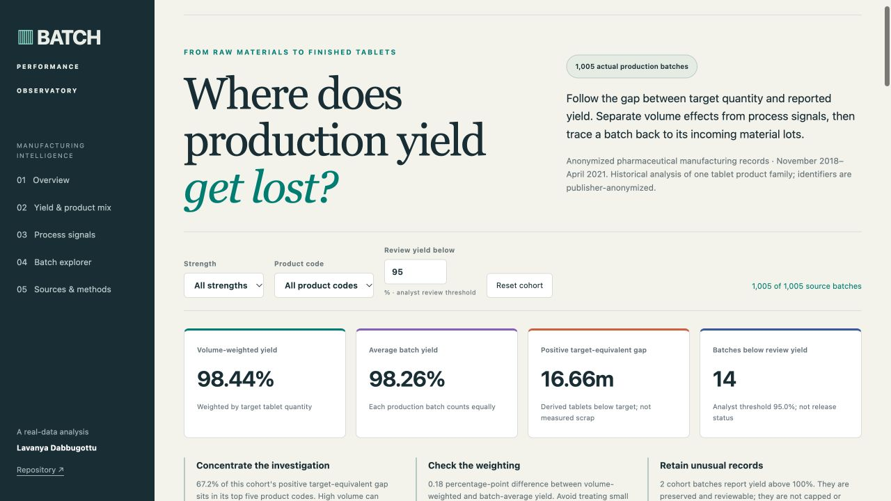

# Manufacturing Performance Observatory

**1,005 actual pharmaceutical production batches. One-to-one batch traceability. Clear manufacturing decisions.**

A manufacturing-performance analysis for business analysts working with production, supply planning, and quality teams. The project uses published, anonymized records from a film-coated tablet product family; no production records are simulated.



## What the analysis found

| Finding | Evidence | Decision it supports |
| --- | --- | --- |
| Production volume changes the yield headline | Volume-weighted yield is **98.44%**, versus **98.26%** when every batch receives equal weight | Report both measures rather than averaging percentages across unequal batch sizes |
| Investigation priorities are concentrated | The top five product codes account for **67.2%** of the positive target-equivalent gap | Investigate high-volume configurations as well as the lowest-yield batches |
| Aggregate associations can conceal product differences | The published press-speed feature's yield correlation changes from **+0.057** to **−0.234** after within-product centering, on the same 987 observations | Compare like configurations before recommending process changes |
| Source anomalies need explicit treatment | **Two** batch yields exceed 100%; whitespace-only measurements are also missing | Preserve source values, surface review cases, and document denominators |

These are descriptive findings, not causal effects, verified cost savings, or batch-release decisions. The positive target-equivalent gap is a derived measure, not recorded scrap.

## Dashboard

The dashboard includes strength/product cohort filters, volume-weighted monthly yield, product-code gap concentration, a yield–drug-release scatterplot, raw versus within-product associations, and a searchable batch/material-lineage explorer. An adjustable yield-review threshold is an analyst control, not a regulatory specification.

**[Open the live dashboard](https://sailavanya909-hue.github.io/biotech-supply-chain-analysis/)** · [Dashboard source](site/)

GitHub Pages publishes the prepared dashboard from **main → /docs**. You can also serve `site/` locally.

## Reproduce

Python 3.9 or newer, standard library only:

```bash
git clone https://github.com/sailavanya909-hue/biotech-supply-chain-analysis.git
cd biotech-supply-chain-analysis
# Original source CSVs are already included. Optional fresh verified download:
python3 src/download_data.py
python3 src/analyze.py
python3 -m unittest discover -s tests -v
python3 -m http.server 8000 --directory site
```

Then open http://localhost:8000. To run the SQL independently, regenerate the SQLite database with the analysis script and execute `sql/analysis.sql` against `data/processed/manufacturing.sqlite3`.

## Review the project

- [Executive findings and decision brief](docs/findings.md)
- [Sources, attribution, and file integrity](docs/sources.md)
- [Methodology and data dictionary](docs/methodology.md)
- [Business requirements and acceptance checks](docs/business-requirements.md)

`data/raw/` contains publisher files unchanged. `data/processed/` contains the joined analysis records and dashboard data. `src/` and `sql/` contain the reproducible analysis; `tests/` contains calculation, integrity, and reconciliation checks. `site/` is the dashboard source. `docs/` contains the Pages-ready dashboard and review documentation.

## Data source and scope

Žagar, J. and Mihelič, J. (2022), *Big data collection in pharmaceutical manufacturing and its use for product quality predictions*. [Paper](https://doi.org/10.1038/s41597-022-01203-x) · [Dataset](https://doi.org/10.6084/m9.figshare.c.5645578). Source data: [CC BY 4.0](https://creativecommons.org/licenses/by/4.0/).

The records cover November 2018–April 2021. Public identifiers are anonymized. This is pharmaceutical tablet manufacturing, not Boston-specific company operations or biologic cell-culture production. Actual stock-on-hand, expiry, prices, supplier lead times, and realized savings are absent and are not invented.
